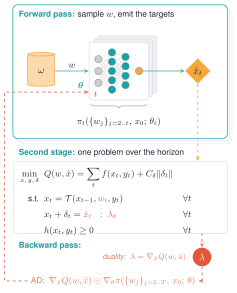
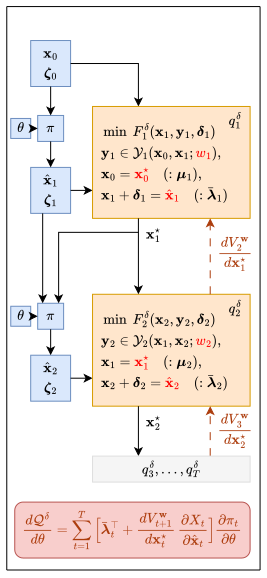
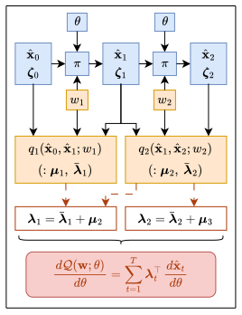

# The TS-DDR framework

```@meta
CurrentModule = DecisionRules
```

Methods for multistage problems approximate either the value function or the
policy. Value-function methods such as SDDP need convex stage problems for their
cuts to be valid; policy methods restrict the form of the decision and optimize
its parameters, and need neither convexity nor stage-wise independence of the
uncertainty. Two-stage linear decision rules are the classical member of the
second family: the state follows an affine function of the observed history, and
training the rule is a two-stage stochastic program whose first-stage decision is
the rule itself. Two-stage generalized decision rules keep that structure and let
the rule be any parametric map, and two-stage deep decision rules (TS-DDR)
instantiate it with a deep recurrent network. What makes the generalization
practical is how it is trained: the second stage is a deterministic problem in
which the targets emitted by the policy enter only as right-hand sides, so the
gradient of its cost with respect to the targets is given by duality, without
differentiating through the solver. This chapter develops that training scheme;
the derivations are in [arXiv:2405.14973](https://arxiv.org/abs/2405.14973), and
the problem class and the classical solution families are in
[Multistage stochastic optimization](@ref).

## Problem setting

Consider the ``T``-stage stochastic control problem of the previous
chapter: at each stage ``t`` we observe an uncertainty realization ``w_t``
and must choose an action ``u_t`` that satisfies
stage constraints ``(u_t, x_t) \in \mathcal{X}_t(x_{t-1}, w_t)``. Restricting
attention to a parametric policy class, the goal is to
minimize the expected total cost over the parameters:

```math
\min_\theta \; \mathbb{E}_{w_{1:T}} \left[ \sum_{t=1}^{T} c_t(x_t, u_t) \right]
```

where ``x_t`` evolves according to the constrained dynamics and ``\theta`` parameterizes
the policy.

## Target-state policies

Instead of mapping observations directly to actions, the policy outputs **target
states**:

```math
\hat{x}_t = \pi_\theta(w_t, \hat{x}_{t-1}), \qquad \hat{x}_0 = x_0,
```

evaluated stage-wise with state feedback: each target is conditioned on the
previous target state during deterministic-equivalent training (or on the
realized state ``x_{t-1}`` in closed-loop rollouts).

A projection subproblem enforces feasibility by solving:

```math
\min_{x_t, u_t} \; c_t(x_t, u_t) + \lambda \| x_t - \hat{x}_t \|
\quad \text{s.t.} \quad (u_t, x_t) \in \mathcal{X}_t(x_{t-1}, w_t)
```

The target ``\hat{x}_t`` enters as a **parameter** (not a decision variable). The
penalty ``\lambda`` on the slack ``\| x_t - \hat{x}_t \|`` ensures that when the target
is feasible, the optimizer follows it exactly; when infeasible, it deviates minimally.

## Gradient computation

The policy gradient with respect to ``\theta`` decomposes via the chain rule:

```math
\nabla_\theta \mathcal{L} =
  \sum_{t=1}^{T} \frac{\partial \mathcal{L}}{\partial \hat{x}_t}
  \cdot \frac{\partial \hat{x}_t}{\partial \theta}
```

The first factor — sensitivity of the loss to the target — comes from the **Lagrange
duals** of the target constraints (or equivalently, from implicit differentiation of the
KKT conditions via DiffOpt). The second factor is a standard neural-network backprop.

This two-stage structure avoids differentiating through the full optimization solver:
dual information provides a first-order signal, and DiffOpt handles the implicit
function theorem when needed (e.g., for state-transition sensitivities).

## Three training formulations

The figures on this page use the notation of the paper. ``x_t`` (bold in the
stage-wise figures) is the state and ``y_t`` the remaining decisions (the ``u_t``
above); ``f`` is the stage cost ``c_t``; the transition ``\mathcal T`` and the
constraints ``h`` together define ``\mathcal X_t``; ``\delta_t`` is the slack of
the target constraint, penalized by ``C_\delta`` (written ``\lambda`` in the
formulas on this page); and ``Q(w, \hat x)`` is the optimal value of the
problem the targets enter. In the figures ``\lambda`` always denotes the
multiplier of the target constraint, and ``\boldsymbol\zeta_t`` is the recurrent
memory of the policy. Inputs drawn in red enter the problems as parameters.

### Deterministic equivalent

All stages are coupled into a single NLP for a sampled trajectory ``w_{1:T}``:

```math
\min_{x, u} \; \sum_{t=1}^T c_t(x_t, u_t) + \lambda \| x_t - \hat{x}_t \|
\quad \text{s.t.} \quad \text{dynamics + constraints for all } t
```

```@raw html
<figure class="dr-fig has-compact">
```
![TS-DDR training. A sampled uncertainty omega drives per-stage policies pi_t that emit a state target x-hat_t for every stage. One deterministic-equivalent problem over the whole horizon minimizes the stage costs plus a penalty on the slack delta_t, subject to the dynamics, the constraints h, and the target constraints x_t + delta_t = x-hat_t, whose multiplier is lambda. By duality lambda is the gradient of the optimal value Q with respect to the targets, and automatic differentiation multiplies it by the policy Jacobian to update theta.](assets/diagrams/tsddr.svg)


```@raw html
<figcaption><b>One problem over the horizon, priced by duality.</b> For a sampled scenario the per-stage policies $\pi_t$ emit every target $\hat x_t$; one deterministic-equivalent problem realizes them, with $w_t$ and the targets (red) as parameters and a penalized slack $\delta_t$ on each target constraint. The multiplier of that constraint is $\lambda = \nabla_{\hat x} Q(w,\hat x)$, and automatic differentiation chains it with $\nabla_\theta \pi$ to give the gradient with respect to the policy weights. Redrawn from Fig. 1 of <a href="https://arxiv.org/abs/2405.14973">arXiv:2405.14973</a>.</figcaption>
</figure>
```

The policy generates targets in a single forward pass, and the coupled solve determines
the realized states. DiffOpt differentiates through the full NLP.

**Pros**: strongest gradient signal (full horizon coupling).
**Cons**: largest subproblem per sample; targets generated without realized-state feedback.

### Stage-wise decomposition (single shooting)

Each stage is solved independently in sequence:

```
for t = 1, ..., T:
    x̂_t = π_θ(w_{1:t}, x_{t-1})       # policy predicts target
    solve stage-t subproblem            # project onto feasible set
    x_t = realized state from solver    # feed back to next stage
```

Gradients combine dual information for targets with DiffOpt sensitivities along the
rollout chain.

```@raw html
<figure class="dr-fig has-compact">
```



```@raw html
<figcaption><b>Decomposed by stages, the penalized problem is solved in sequence.</b> Stage $t$ receives the realized state $\mathbf x^\star_{t-1}$, implements its target up to the penalized discrepancy $\boldsymbol\delta_t$, and hands $\mathbf x^\star_t$ to the next stage and to the rule. The gradient of a target adds to its multiplier $\bar{\boldsymbol\lambda}_t$ its effect on the later stages, which the dashed chain $dV^{\mathbf w}_{t+1}/d\mathbf x^\star_t$ carries backward along the path through the solution sensitivities of each stage problem (purple), computed with DiffOpt. In the narrow layout, $F^\delta_t=f(\mathbf x_t,\mathbf y_t)+C^\delta_t\lVert\boldsymbol\delta_t\rVert$ abbreviates the penalized stage cost.</figcaption>
</figure>
```

**Pros**: closed-loop policy (sees realized states); smaller per-stage solves.
**Cons**: sequential; gradient signal weakens over long horizons.

### Multiple shooting

The horizon is partitioned into windows of ``W`` stages. Each window solves a
deterministic equivalent over its stages, then passes the realized end-state to the
next window:

```
for k = 1, ..., ⌈T/W⌉:
    solve window-k deterministic equivalent (stages (k-1)W+1 to kW)
    pass realized end-state to window k+1
```

**Pros**: balances coupling (within windows) with tractability; cheaper inner
solves than a full-horizon deterministic equivalent.
**Cons**: windows are chained sequentially during rollout/training because each
window needs the previous realized end-state; cross-window coupling is weaker
than in the full deterministic equivalent.

## Beyond the pure dual gradient

The dual gradient above is exact for smooth subproblems and unbiased over
fresh samples. Two extensions handle the situations where that is not
enough — **discrete decisions**, where the dual is local to a fixed
integer assignment and a score-function (REINFORCE) correction restores
the missing signal, and **small sample budgets**, where a control-variate
critic reduces the estimator's variance without moving its optimum. Both
are developed, together with a risk-averse change-of-measure variant, in
[Extensions: mixed gradients, critics, and risk](@ref); the score-function
correction is exercised in the
[Stochastic Lot-Sizing with Fixed Ordering Costs](@ref) case study.

## Penalty annealing

The target penalty ``\lambda`` is critical: too small and the optimizer ignores
targets (no gradient); too large and the problem becomes ill-conditioned. DecisionRules.jl
supports a **penalty annealing schedule** that ramps ``\lambda`` during training:

```
Phase 1 (warmup):  λ × 0.1   — let the policy explore
Phase 2 (nominal): λ × 1.0   — standard training
Phase 3 (tighten): λ × 10.0  — sharpen target tracking
Phase 4 (lock):    λ × 30.0  — final precision
```

This is the `default_annealed` schedule, activated with `penalty_schedule=:default_annealed`.

## Strict mode: penalty-free gradient signal

The standard TS-DDR formulation uses a penalty ``C_\delta \|\delta_t\|`` to
penalize deviations from the policy's targets. While effective, the penalty
introduces a trade-off: the dual ``\lambda_t`` conflates the **economic shadow
price** with a **penalty-correction term**. At high penalty, the gradient
signal tells the policy "reduce ``\delta``" rather than "be economically
optimal."

**Strict mode** eliminates this coupling entirely by replacing the slack
constraint ``x_t + \delta_t = \hat{x}_t`` with a **hard equality**:

```math
x_t = \hat{x}_t \quad :\lambda_t
```

There are no deficit variables, no penalty term, and no penalty to tune. The
dual ``\lambda_t`` is the **pure shadow price** ``\partial Q_t / \partial
\hat{x}_t`` — the marginal value of changing the target, uncontaminated by
any regularization.

```@raw html
<figure class="dr-fig has-compact">
```
![Strict targets over a horizon. A recurrent policy with shared weights theta emits each target and memory from the realized uncertainty and the previous target and memory. Stage problem t fixes its incoming state to the previous target and its outgoing state to the current target, so the stage problems are solved independently. The multiplier of the incoming-state constraint of stage t+1 and of the outgoing-state constraint of stage t add up to lambda_t, and the sum of lambda_t times the policy Jacobian is the gradient with respect to theta.](assets/diagrams/decision-rules--parallel-stages.svg)


```@raw html
<figcaption><b>Strict targets separate the problem into stage problems solved in parallel.</b> Adjacent targets and the current realization define each stage problem $q_t$, and no stage problem receives anything from another. Each target is priced twice, as the outgoing state of its stage ($\bar{\boldsymbol\lambda}_t$) and as the incoming state of the next stage ($\boldsymbol\mu_{t+1}$), and the sums form the gradient with respect to the shared weights. Each copy of the policy includes the map into the reachable set described below.</figcaption>
</figure>
```

### The condition: target reachability

A hard equality has no slack to absorb an unreachable target, so strict mode
is well-posed under exactly one condition: **every target the policy emits
must be attainable from the state the system is in when the corresponding
stage is solved.** Formally, let

```math
R(x, w) \;=\; \bigl\{\, x' \;:\; \exists\, u \text{ with }
  (u, x') \in \mathcal{X}(x, w) \,\bigr\}
```

denote the **one-stage reachable set** — the states attainable from ``x``
under realization ``w`` by some admissible action. Strict mode requires
``\hat{x}_t \in R(x_{t-1}, w_t)`` at every stage, where ``x_{t-1}`` is the
*realized* state.

A **feasibility-guaranteeing policy** enforces this by construction: it
computes (an inner approximation of) ``R`` from its input state and maps the
network output into that set, typically by scaling a sigmoid-bounded output
across the reachable interval. The bounds carry no gradient; the gradient path
is solely through the network output, exactly as in the standard TS-DDR
pipeline. Constructing ``R`` is problem-specific. It is cheap whenever the
dynamics are linear in the controls with box bounds — resource-balance
equations are the canonical case. The
[battery-storage study](@ref "Stochastic battery-storage AC optimal power flow")
derives the battery-dynamic interval and explains why a network-constrained OPF
still needs an empirical strict-feasibility gate.

### Validity in every formulation, by induction

Reachability of each target from the *policy's input state* is enough to make
strict mode well-posed in **all** training formulations — stage-wise
subproblems, the embedded deterministic equivalent, and the regular
deterministic equivalent alike. The argument is one induction, and the strict
equality itself is what carries it: suppose ``\hat{x}_0 = x_0`` (the known
initial state) and every policy call returns a target reachable from the state
it conditioned on,

```math
\hat{x}_t = \pi_\theta(w_t, \hat{x}_{t-1}) \in R(\hat{x}_{t-1}, w_t).
```

1. Stage 1 is feasible: ``\hat{x}_1`` is reachable from the true initial
   state ``x_0 = \hat{x}_0``.
2. If stages ``1, \ldots, t`` are feasible, their strict equalities force
   ``x_s = \hat{x}_s`` for ``s \le t``. The state the policy conditioned on
   when producing ``\hat{x}_{t+1}`` is therefore *identical* to the realized
   state ``x_t``, so ``\hat{x}_{t+1} \in R(x_t, w_{t+1})`` and stage ``t+1``
   is feasible.

The formulations differ only in *which symbol* plays the policy input. In
stage-wise rollouts the policy reads the realized state ``x_{t-1}`` directly;
in the embedded DE it reads the solver's state variables; in the regular DE it
reads its own previous target ``\hat{x}_{t-1}``. Under strict equalities these
are the same object — the induction shows previous target ``\equiv`` previous
realized state — so no formulation is a special case and none needs a separate
argument. In particular, the regular DE is *not* an exception requiring extra
structure: the strict equality **closes the loop as a consequence**, it does
not presuppose a closed loop.

### Information pattern: closed-loop vs. open-loop

Distinct from the well-posedness question is the **information pattern**: does
the policy read the *realized* state (closed-loop feedback) or its *own
previous target* (open-loop target generation)? This axis matters
independently of strict mode:

- In **non-strict** training, slack lets the realized state deviate from the
  target, so the two inputs genuinely differ. A regular DE trains the policy
  on target feedback while the optimizer realizes something else — a
  train/deploy mismatch that shows up at evaluation (below).
- Under **strict equalities** the distinction collapses: realized state and
  target are identical at every stage, so target feedback and realized
  feedback are the same function evaluation, and training-time DE solves and
  deployment-time stage-wise rollouts traverse identical trajectories.

Keeping the two axes separate is the point: *strict-mode validity* is about
reachability of targets; *closed- vs. open-loop* is about what information the
policy consumes. Strict mode does not require closed-loop evaluation — it
makes the question moot by forcing the two information patterns to coincide.

### When to use strict mode

Whenever it is applicable — a feasible initial state and a policy constructed
to emit only **one-stage reachable** targets — strict mode is the preferred
formulation. The only reason to fall back to the penalty formulation is
numerical: some solvers degrade when the additional hard equality constraints
are imposed (the equalities remove the slack that otherwise absorbs small
constraint violations during intermediate iterates).

Everything else follows as a beneficial side effect rather than a selection
criterion: there is no penalty hyperparameter to tune, no annealing schedule,
and the dual ``\lambda_t`` is the exact shadow price of the target — the
gradient signal is uncontaminated by a regularization term.

In the
[battery-storage AC-OPF study](@ref "Stochastic battery-storage AC optimal power flow"),
strict mode is accepted only after representative true-ACP rollouts solve with
zero load shedding. This distinguishes dynamic reachability from full network
feasibility.

## Evaluation semantics

A policy trained on the (non-strict) deterministic equivalent generates targets
using **target-state feedback** (each target depends on the previous *predicted*
target, not the realized state). Evaluating such a policy with **realized-state
feedback** (deployment semantics) tests a different closed-loop path and will
generally report higher cost. Under strict equalities the two modes coincide —
realized states equal targets identically — so the choice below is material
only when slack is present.

[`RolloutEvaluation`](@ref) supports both modes via the `policy_state` keyword:
- `:target` — matches DE training semantics (fair in-sample comparator)
- `:realized` — deployment/closed-loop semantics (the true test)

The **target-violation share** measures how much of the rollout objective comes from
the slack penalty rather than operational cost. A small share (≤ 5%) means the policy's
targets are followable stage-by-stage; a large share signals that the coupled DE solve
was absorbing infeasible targets through slack.
