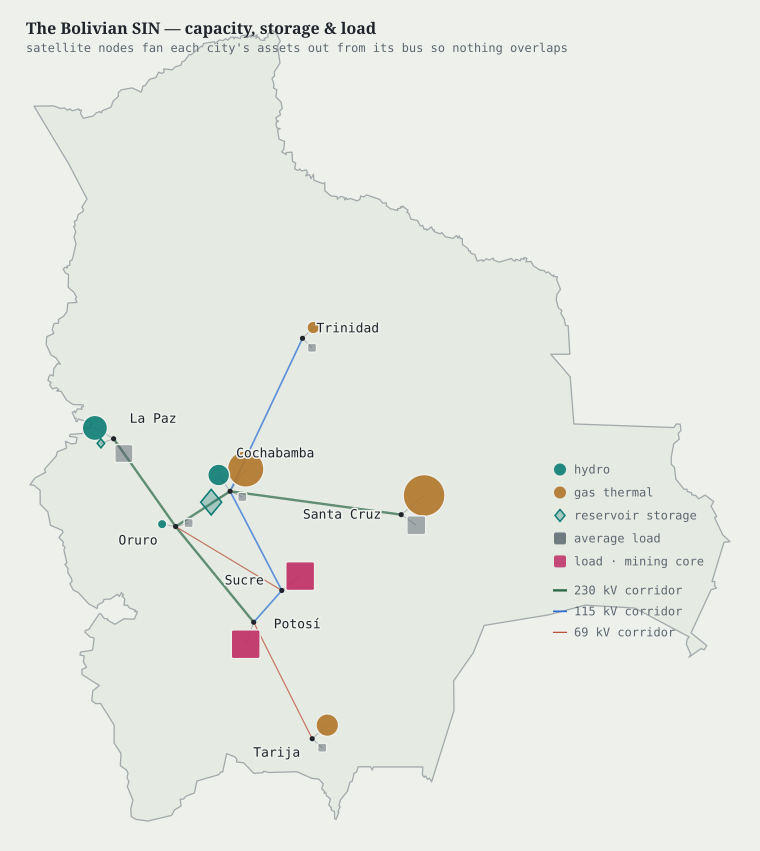
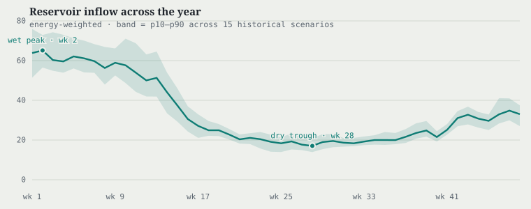

# The long-term hydrothermal planning problem

```@meta
CurrentModule = DecisionRules
```

Long-term hydrothermal dispatch determines, at weekly stages over a horizon of
several years, the turbined outflow and spillage of every hydro plant and the
dispatch of the thermal units, so as to minimize the expected operating cost
subject to the reservoir dynamics, the network constraints and the uncertainty of
inflows. Hydro generation has no direct cost. Its economic value is the
opportunity cost of the stored water, the expected thermal cost that the water
displaces in later stages, and this value depends on the distribution of future
inflows and on the capacity of the network to deliver the energy to the loads.

This page states the problem as the case study solves it: the reservoir dynamics,
the conversion of water into power on an AC network, the planning problem and the
value of water it defines, the stage problem that a target-state policy solves,
and the instance. How each method values water is the subject of
[Valuing water: two approaches](@ref).

## Reservoirs and cascades

Time is divided into weekly stages ``t = 1, \ldots, T``. The state is the vector
of reservoir volumes ``x_t = (v_{r,t})_{r \in \mathcal{R}}``, and the uncertainty
revealed at the start of each stage is the vector of river inflows
``w_t = (w_{r,t})_{r \in \mathcal{R}}``. Within the stage the operator chooses
the turbined outflow ``q_{r,t}`` and the spillage ``s_{r,t}`` of every plant, the
thermal dispatch, and the operating point of the network. Rivers form cascades:
the water released by an upstream plant reaches the plant below it within the
same week, so the volume of each reservoir evolves by the water balance

```math
v_{r,t} \;=\; v_{r,t-1}
  + K \Bigl( w_{r,t} - q_{r,t} + \sum_{u \in \mathcal{U}_r} q_{u,t} \Bigr)
  - s_{r,t} + \sum_{u \in \mathcal{S}_r} s_{u,t},
\qquad
\underline{v}_r \le v_{r,t} \le \overline{v}_r ,
```

where ``\mathcal{U}_r`` and ``\mathcal{S}_r`` are the plants whose turbined and
spilled water, respectively, flow into reservoir ``r``, and
``\underline{q}_r \le q_{r,t} \le \overline{q}_r``, ``s_{r,t} \ge 0``. The factor
``K`` converts a flow sustained over the stage into a volume and is proportional
to the stage length; for a week of 168 hours it is ``K = 0.0036 \times 168 =
0.6048``. Inflow and turbined flow are rates while spillage is carried as a
volume, the convention of HydroPowerModels that every engine of the case study
reproduces. The water balance is the only constraint that couples consecutive
stages: everything else the operator faces is contained within the week.

## From water to electricity

A hydro plant converts turbined flow into active power through its production
factor, ``p_{r,t} = \rho_r\, q_{r,t}``. Production factors differ by nearly an
order of magnitude across the plants of the case study, and a plant at the head
of a cascade passes its released water to the plant below, which turbines it
again. A volume of water therefore does not correspond to a fixed quantity of energy:
its value depends on where it is stored and on the plants it will pass through.

Within each stage the dispatch satisfies the AC power-flow equations on the
transmission network. With bus voltages ``|V_i| e^{j\varphi_i}`` and the
conductance and susceptance ``G_{ik}, B_{ik}`` of the bus admittance matrix, the
active and reactive balances at bus ``i`` read

```math
\begin{aligned}
\sum_{g \in \mathcal{G}_i} p_{g,t} + \sum_{r \in \mathcal{R}_i} p_{r,t}
  - P^{d}_{i,t} + \Delta_{i,t}
  &= |V_i| \sum_{k} |V_k| \bigl( G_{ik} \cos\varphi_{ik} + B_{ik} \sin\varphi_{ik} \bigr), \\
\sum_{g \in \mathcal{G}_i} q_{g,t} - Q^{d}_{i,t}
  &= |V_i| \sum_{k} |V_k| \bigl( G_{ik} \sin\varphi_{ik} - B_{ik} \cos\varphi_{ik} \bigr),
\end{aligned}
```

with ``\varphi_{ik} = \varphi_i - \varphi_k``, together with voltage bands,
apparent-power limits at both ends of every branch, and generator capabilities.
These equations are nonconvex in the voltages, and through them losses, reactive
support and voltage limits make the cost of delivery depend on where power is
produced and consumed. The variable ``\Delta_{i,t} \ge 0`` is the unserved load at
bus ``i``, priced far above the most expensive generator. It gives every stage
relatively complete recourse in the active-power balance: for every incoming
state and every reachable target, the stage problem remains feasible.
Spillage is unbounded, so no slack is needed on the other side. The reactive
balance has no slack and is enforced exactly.

## The planning problem and the value of water

The stage cost is the fuel cost of the thermal units plus the cost of unserved
load,

```math
c_t(x_t, u_t) \;=\; \sum_{g \in \mathcal{G}} C_g\bigl(p_{g,t}\bigr)
  + C_{\Delta} \sum_{i \in \mathcal{N}} \Delta_{i,t},
```

and hydro generation costs nothing at the stage level. Its cost is the
opportunity cost of the water withheld, which appears only through the
intertemporal coupling. The planning problem is the instance of
[Multistage stochastic optimization](@ref) in which the operator chooses a
nonanticipative policy to minimize the expected total cost over the horizon,
subject to the water balance and the AC equations at every stage. Its dynamic
programming formulation defines a cost-to-go ``V_{t+1}(x_t)``, and the negative of
its gradient with respect to the volume of reservoir ``r``,
``-\partial\, \mathbb{E}[V_{t+1}] / \partial v_{r,t}``, is the marginal value of
water in that reservoir.

The water value has a temporal, a spatial and a stochastic component. Water
released in one week is unavailable in later weeks, and when the demand peak
falls in the dry season, as in the Bolivian system, the stages in which water is
most valuable are those in which inflows are lowest. Through the production
factors and the cascade topology, the same volume corresponds to different
amounts of energy at different plants, and the network constraints determine how
much of that energy reaches the loads. And every release is decided before the
next inflow is observed, so an optimal policy hedges against the distribution of
inflows rather than against a single forecast. A myopic policy, which assigns zero
value to stored water, ignores all three components.

## The policy implementation problem

A target-state policy does not decide releases. At every stage it emits a target
``\hat v_{r,t}`` for the end-of-week volume of every reservoir, and the stage
problem dispatches the system with the volume pinned to that target,
``v_{r,t} = \hat v_{r,t}``. The multiplier ``\lambda_{r,t}`` of this equality is
the sensitivity of the stage cost to the target, a price for water read directly
from the AC problem; [Valuing water: two approaches](@ref) explains how it trains
the policy. The equality is well posed only if the target can actually be reached
in one week from the incoming volume, so the policy must emit targets inside the
one-stage reachable set.

### One-stage reachable sets

The water balance is linear in the releases, so the set of volumes that reservoir
``r`` can reach in one stage is an interval, obtained by setting the releases at
their bounds:

```math
u_r = \min\Bigl(\overline{v}_r,\;
    v_r + K w_r - K \underline{q}_r + \sum_{u \in \mathcal{U}_r} K \overline{q}_u\Bigr),
\qquad
\ell_r = \max\bigl(\underline{v}_r,\; v_r + K w_r - K \overline{q}_r - \overline{s}_r\bigr),
```

with ``\ell_r = \underline{v}_r`` when spillage is unbounded, since a reservoir
can always be drawn down to its minimum. The policy maps an unconstrained output
``z_r`` of the network into this interval,
``\hat v_r = \ell_r + (u_r - \ell_r)\,\sigma(z_r)``. The bounds depend on the
incoming volume and on the realized inflow, and because the incoming volume is the
previous stage's target, they are part of what couples the stages in the policy's
gradient.

The upper bound assumes that every upstream plant releases at its turbine
capacity. When an upstream reservoir holds water back, less reaches the reservoir
below, and a downstream target computed from the capacity bound could be
unreachable. The policy therefore processes the reservoirs in topological order
along each cascade. For a link ``u \to d``, the release implied by the upstream
target is ``R_u = K w_u + v_u - \hat v_u``; the contribution reaching ``d`` is
``\max(0, R_u)`` when both turbined and spilled water flow downstream, and
``\min(K \overline{q}_u, \max(0, R_u))`` when only turbined water does; and the
downstream target is limited to

```math
\hat v_d \;\le\; \min\bigl(\overline{v}_d,\;
    v_d + K w_d - K \underline{q}_d + \text{contribution}_{u \to d}\bigr).
```

This construction is exact for cascades of one level, the topology of the
Bolivian system, and conservative for longer chains. With it, every target the
policy emits is reachable from the state it was conditioned on, and by induction
the whole target trajectory is feasible (see
[Validity in every formulation, by induction](@ref)).

## The Bolivian system

The instance is the Bolivian interconnected system: 28 buses, 31 branches and 34
generators, of which 11 are hydro units arranged in three cascades. The network is
meshed, but its three loops close only through lower-voltage lines in the central
mining region, and the transfers from the hydro plants in the north-west and the
gas plants in the east to the loads follow essentially radial corridors.

```@raw html

```

Two of the cascade links carry both turbined and spilled water downstream; on the
third, only the turbined water of the system's one large seasonal reservoir
reaches a run-of-river plant immediately below it. Every unit of water released at
the head of that cascade is therefore converted twice, and its marginal value includes both production factors. Inflows are strongly seasonal and spatially
correlated across the basins; they are modelled as stage-wise independent, with
equiprobable joint realizations per week built from the historical record, and
they are the only source of uncertainty. Demand follows a deterministic profile whose peak falls in the dry season, so
that the comparison concerns only the valuation of water.

```@raw html

```

Policies are trained and simulated over 126 weeks and scored over the first 96, so
that the additional weeks remove the incentive to empty the reservoirs at the end
of the reported horizon. The reservoirs start empty, and unserved load is priced
at 6000 per per-unit (100 MW) of power and stage. The case files, their hashes and the
invariants derived from them are recorded in a manifest that both engines verify
before building a model.
