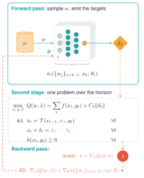

# DecisionRules.jl

```@meta
CurrentModule = DecisionRules
```

```@raw html
<p class="dr-eyebrow">Multistage policies · State targets · Dual gradients</p>
<figure class="dr-fig has-compact">
```
![TS-DDR training. A sampled uncertainty omega drives per-stage policies pi_t that emit a state target x-hat_t for every stage. One deterministic-equivalent problem over the whole horizon minimizes the stage costs plus a penalty on the slack delta_t, subject to the dynamics, the constraints h, and the target constraints x_t + delta_t = x-hat_t, whose multiplier is lambda. By duality lambda is the gradient of the optimal value Q with respect to the targets, and automatic differentiation multiplies it by the policy Jacobian to update theta.](assets/diagrams/tsddr.svg)


```@raw html
<figcaption><i>Policies emit a state target for every stage, one deterministic-equivalent problem realizes them, duality prices them, and automatic differentiation carries the price back to the policy weights. Redrawn from Fig. 1 of <a href="https://arxiv.org/abs/2405.14973">arXiv:2405.14973</a>.</i></figcaption>
</figure>
<p class="dr-lede">A policy for a constrained multistage system must return actions that satisfy the operating model at every stage. DecisionRules.jl trains policies whose outputs are state targets, realized by an optimization over the operating model written in JuMP, with gradients read from the multipliers of the target constraints instead of differentiated through solver iterations. It implements two-stage generalized decision rules (TS-GDR) and their deep instantiation, two-stage deep decision rules (TS-DDR), introduced in <a href="https://arxiv.org/abs/2405.14973">arXiv:2405.14973</a>.</p>
```

## Where to go next

**Part I, Theory**, states the
[multistage stochastic optimization problem](@ref "Multistage stochastic optimization")
and the solution families it admits, develops
[the TS-DDR framework](@ref "The TS-DDR framework") and its strict formulation,
presents [stochastic dual dynamic programming](@ref "Stochastic dual dynamic programming")
as used by the baselines, including its variant for nonconvex stage problems, and
discusses [extensions](@ref "Extensions: mixed gradients, critics, and risk") to
integer decisions, control variates and risk measures.

**Part II, Package guide**, covers [getting started](@ref "Getting started"),
[uncertainty sampling formats](@ref "Uncertainty Sampling"),
[gradient fallback](@ref "Gradient Fallback"),
[GPU acceleration](@ref "GPU Acceleration with DecisionRulesExa.jl"), a guide to
[reading the code](@ref "Reading the code") of both packages and their examples,
and the [API Reference](@ref).

**Part III, Case studies**, documents
[long-term hydrothermal planning](@ref "Long-term hydrothermal planning") on the
Bolivian system,
[stochastic battery-storage AC optimal power flow](@ref "Stochastic battery-storage AC optimal power flow"),
[rocket control](@ref "Rocket Control") and
[stochastic lot-sizing](@ref "Stochastic Lot-Sizing with Fixed Ordering Costs").
The code that reproduces the case studies is in the `examples` directory of this
package and of DecisionRulesExa.jl; its
[README](https://github.com/LearningToOptimize/DecisionRules.jl/tree/main/examples)
is the entry point.

## What the package provides

The user describes the problem as one JuMP model per stage, marks the incoming
state, the targets and the uncertainty as parameters, and supplies a sampler of
uncertainty trajectories. A policy, from an affine rule to a deep recurrent
network built with Flux.jl, is then trained by stochastic gradient descent in
one of three formulations:

| Formulation | Solved per sampled trajectory | Gradient through |
|:--|:--|:--|
| Deterministic equivalent | one problem over the whole horizon | multipliers of the target constraints |
| Stage-wise rollout (single shooting) | one problem per stage, in sequence | multipliers plus DiffOpt.jl sensitivities of the realized states |
| Windowed (multiple shooting) | one problem per window, chained by end states | multipliers within a window, sensitivities across windows |

Targets are enforced either through a penalized slack, which applies to any
model, or, when the states reachable in one stage are known in closed form, as
hard equalities on targets that the policy is constructed to keep reachable.
The package also provides recurrent and state-conditioned policy architectures,
dual-gradient extraction for mixed-integer stage models with an optional
score-function correction, and rollout evaluation with checkpoint selection on
fixed scenarios. The companion package
[DecisionRulesExa.jl](https://github.com/LearningToOptimize/DecisionRulesExa.jl)
trains the same policies with the deterministic-equivalent formulation on GPUs,
using ExaModels.jl and MadNLP.jl.

## Installation

```julia
using Pkg
Pkg.add("DecisionRules")
```

[Getting started](@ref) covers solver requirements, a first example, and the
choice among the training formulations.

## Citation

```bibtex
@article{rosemberg2024efficiently,
  title={Efficiently Training Deep-Learning Parametric Policies using Lagrangian Duality},
  author={Rosemberg, Andrew and Street, Alexandre and Vallad{\~a}o, Davi M and Van Hentenryck, Pascal},
  journal={arXiv preprint arXiv:2405.14973},
  year={2024}
}
```
